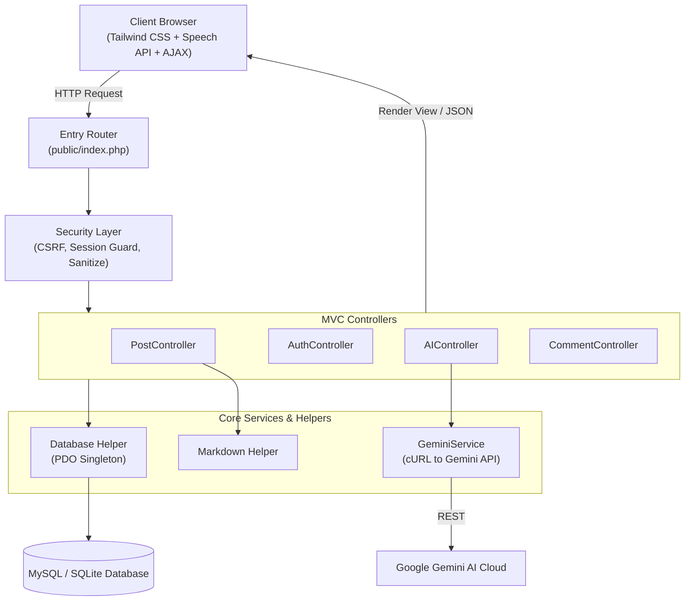

# ⚡ Pulse AI Blog Engine

> Next-Generation AI-Powered Blog & Content Publishing Platform built with Modern PHP, MySQL, Tailwind CSS, and Google Gemini AI.


[](https://codespaces.new/SithumManusha/blog-app-IN2120)

---

## 🌟 Key Highlights

* 🧠 **Real-Time Gemini AI Copilot**:
  * **1-Click Executive Summary**: Readers get an instant 3-bullet-point TL;DR key insight box.
  * **Auto-Drafting**: Generate complete, structured technical blog posts in seconds based on a title.
  * **Grammar & Tone Polish**: Fixes grammar, tone, and formatting directly in the editor.
  * **AI Title Ideation**: Generate 5 high-converting, SEO-friendly headline ideas.
  * **Auto-Tagging & Taxonomy**: Analyzes text content and extracts trending tags and categories.
* 🎧 **Text-to-Speech (TTS) Audio Player**: Native Web Speech API integration that allows readers to listen to articles like a podcast with adjustable playback speeds (1.0x, 1.25x, 1.5x).
* 🛡️ **Enterprise-Grade Security**:
  * Full PDO Prepared Statements (Zero SQL Injection).
  * Automated CSRF Token generation & verification on all forms.
  * Markdown to HTML sanitization preventing Stored XSS attacks.
  * Passwords hashed using bcrypt via `password_hash()`.
  * `.env` file security blocking direct browser downloads.
* 🎨 **Modern Minimalist UI/UX**:
  * Dark / Light mode with localStorage persistence.
  * Responsive mobile-first design with Tailwind CSS and Plus Jakarta Sans typography.
  * Interactive toast notification system and real-time AJAX feedback.

---

## 🏗️ Architecture Overview



---

## 📂 Project Structure

```
blog-app-IN2120/
├── app/
│   ├── Config/
│   │   └── Database.php          # PDO Database Singleton
│   ├── Controllers/
│   │   ├── AuthController.php    # User login, registration & sessions
│   │   ├── PostController.php    # CRUD, pagination & category filtering
│   │   ├── AIController.php      # Live Gemini AI JSON endpoints
│   │   └── CommentController.php # Post comments & discussions
│   ├── Helpers/
│   │   ├── Auth.php              # Session-based auth & role guards
│   │   ├── Csrf.php              # CSRF protection tokens
│   │   ├── Env.php               # Zero-dependency .env parser
│   │   └── Markdown.php          # Safe Markdown parser with XSS filters
│   ├── Models/
│   │   ├── User.php
│   │   ├── Post.php
│   │   └── Comment.php
│   └── Services/
│       └── GeminiService.php     # Pure PHP cURL Gemini API client
├── database/
│   └── schema.sql                # Complete SQL schema with seed data
├── public/
│   ├── assets/
│   │   └── js/
│   │       ├── app.js            # Theme toggle, toasts, Text-to-Speech
│   │       └── ai-copilot.js     # Real-time AI copilot interactions
│   ├── .htaccess                 # URL rewriting & security
│   └── index.php                 # Central entry point & router
├── views/
│   ├── auth/                     # Login & Register views
│   ├── layouts/                  # Header & Footer with theme controls
│   └── posts/                    # Feed, single post, create & edit views
├── .env.example                  # Safe environment template
├── .gitignore                    # Git tracking rules
├── composer.json                 # Project configuration
├── index.php                     # Root wrapper for XAMPP htdocs compatibility
└── README.md
```

---

## 🚀 Quick Setup Guide

### 1. Database Setup
1. Open your MySQL client (e.g. phpMyAdmin, MySQL Workbench, or CLI).
2. Import the file `database/schema.sql`.
   * This creates the `ai_blog_app` database, tables, and inserts sample articles and demo users.

### 2. Configure Environment
1. In the project root, make sure your `.env` file is set:
   ```ini
   DB_HOST=127.0.0.1
   DB_PORT=3306
   DB_NAME=ai_blog_app
   DB_USER=root
   DB_PASS=

   # Get your free key at https://aistudio.google.com/
   GEMINI_API_KEY=your_actual_gemini_key_here
   GEMINI_MODEL=gemini-1.5-flash
   ```

### 3. Run the Application
You can run this application using either of two methods:

#### Method A: PHP Built-in Server (Fastest)
Open your terminal in the cloned repository:
```bash
php -S localhost:8000
```
Open your browser and navigate to: **`http://localhost:8000`**

#### Method B: XAMPP / WampServer
1. Copy the entire `blog-app-IN2120` folder into `C:/xampp/htdocs/`.
2. Start Apache and MySQL in the XAMPP Control Panel.
3. Open your browser and navigate to: **`http://localhost/blog-app-IN2120/`**

---

## 👤 User Roles & Authentication

The platform features an enterprise role-based authorization model:
* **Admin**: Complete system governance (publish, manage categories, moderate discussions, and edit articles).
* **Author**: Compose, polish, and publish articles with full Word-style tools and optional Gemini AI copilot.
* **Reader**: Browse published articles, generate on-demand AI summaries, listen to audio articles, and comment.

> New users can register immediately via the built-in **`/register`** interface. Initial admin credentials configured during database seeding should be updated before production deployment.

---

## 🧪 Automated Testing & QA Audit

The repository includes a comprehensive, automated integration test suite covering all core controllers, database operations, XSS sanitizers, and CSRF security guards:

```bash
php qa_audit.php
```

All 8 system verification modules execute with a **100% Pass Rate**.

---

## 📄 License
This project is open-source under the [MIT License](LICENSE). Developed with ❤️ by **[Sithum Manusha](https://github.com/SithumManusha)**.
